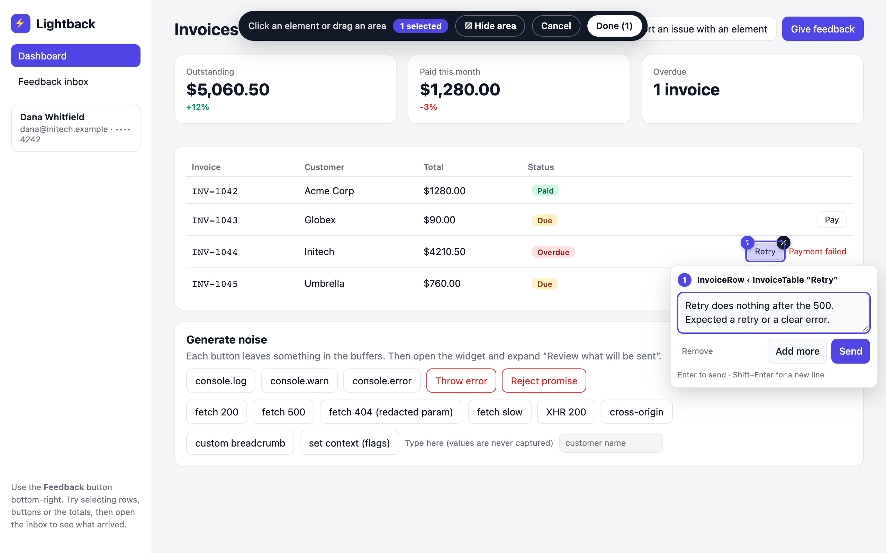
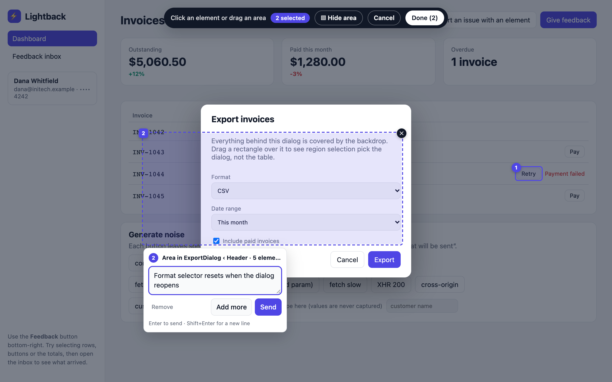
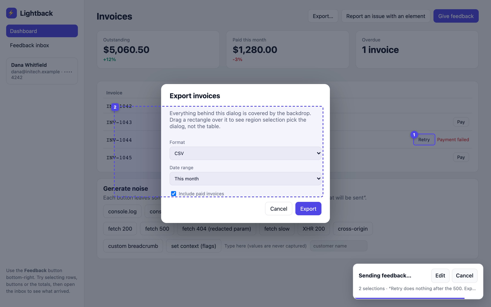
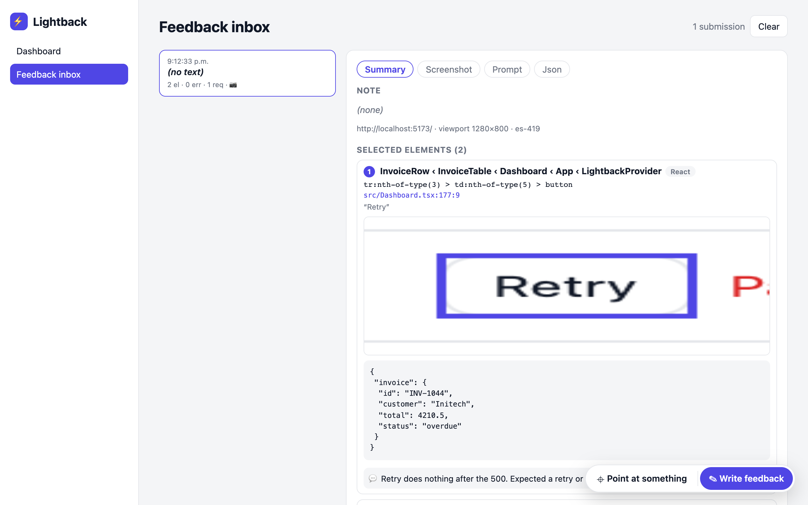

# Lightback

[](https://www.npmjs.com/package/@lightback/widget)



Framework-agnostic in-app feedback capture. Users pick the elements they are talking about, write a note, optionally attach a screenshot, and submit. The payload carries the context a developer or a model needs: component chain for each selected element, console output, errors, network requests, breadcrumbs, environment and whatever app context you attach. Nothing leaves the browser until the user sends; sending shows a cancel window, and the full preview is one click away.

## Packages

| Package | What it is |
| --- | --- |
| `@lightback/core` | Collectors, ring buffers, redaction, element inspection, payload builder, transport. No UI, no dependencies. |
| `@lightback/widget` | Drop-in UI: trigger button, element picker, notes, screenshot, review and send. Vanilla TypeScript inside a Shadow DOM. |
| `@lightback/react` | `LightbackProvider`, `useLightback()`, `useLightbackWidget()`. |
| `@lightback/vue` | Vue 3.5+ lifecycle/context composables and a reactive widget ref. |
| `@lightback/svelte` | Svelte 5 lifecycle/context helpers and a widget store (ESM). |
| `@lightback/source` | Optional build-time JSX/TSX, Vue and Svelte source stamping. |
| `@lightback/mcp` | Optional local receiver, coding-agent MCP tools and browser follow-up thread. Node 22+. |
| `examples/playground` | Vite + React demo app with a mock backend and an inbox that renders what arrived. |
| `e2e` | Playwright suites for Chromium, Firefox and WebKit. |

## Quick start

```sh
pnpm add @lightback/core @lightback/widget
# Optional screenshots:
pnpm add modern-screenshot
```

[Getting started](docs/guide/getting-started.md) walks through mounting the widget and receiving your first report. React apps can also add `@lightback/react`.

## Try the playground

[Open the interactive demo](https://aleandros.github.io/lightback/demo/) — select an element or drag a region, send a report, then inspect its screenshots, prompt and JSON in the inbox. Reports stay in this browser; the latest 20 are kept until you clear the inbox or site storage. Payments and network failures are simulated. No signup or backend is needed.

From a clone of this repository:

```bash
pnpm install
pnpm dev          # http://localhost:5173
pnpm test                 # unit and deterministic property tests (vitest)
pnpm build
pnpm e2e    # browser suites; needs `pnpm dev` running and a system Chrome
```

## Send feedback to a coding conversation

The optional `@lightback/mcp` package connects a local frontend to **Claude Code or Codex**. The agent reads annotated reports and PNGs, edits the app with its own tools, and sends progress/results back to an optional browser thread. Follow-ups reopen the same report with revision checks. Ask the conversation to watch Lightback explicitly; installing MCP does not start an agent turn.

Register the stdio server with your coding host and connect your existing client through `send` or `endpoint`. The MCP command starts or reuses the local receiver automatically; no separate server terminal is needed. The queue survives agent reconnects and keeps reports in memory for 30 minutes; stopping the receiver clears it. No hosted service or provider credentials are required by Lightback. Browser packages retain their existing dependency direction.

See the [Claude Code and Codex walkthrough](docs/guide/coding-agents.md) for npm installation, source-checkout setup, client configuration, image support, isolation and validation. Install the optional bridge with `npm install --save-dev @lightback/mcp`.

## Compatibility and script tags

Packages ship ESM and CommonJS with matching TypeScript declarations, targeting ES2020; `@lightback/svelte` is ESM-only to match Svelte’s runtime.

| Environment | Support |
| --- | --- |
| Browsers | Evergreen releases from the last two years; Safari 15.4+ |
| SSR / Node | Node 18+ for imports and client creation; collectors are inactive on the server |
| Development and CI | Node 22 and pnpm 10 |

`describeElement`, `describeRegion` and `mountWidget` require a browser DOM and throw a clear error on the server. Mount after the DOM is ready. UUID generation falls back when `crypto.randomUUID` is unavailable; screenshot cropping can decode with an image/canvas when `createImageBitmap` is unavailable.

For a script-tag install, build and serve `packages/widget/dist/lightback.iife.js`:

```html
<script src="/vendor/lightback.iife.js"></script>
<script>
  const client = Lightback.createLightback({ endpoint: '/api/feedback' });
  Lightback.mountWidget({ client }); // Place after the page body is ready.
</script>
```

The standalone script includes core and exposes `window.Lightback`. Since widget `0.1.1` it also exposes `Lightback.defaultStrings` for script-tag translations, and since `0.2.2` `Lightback.domCapturer`. The current release is widget `0.2.2`, core `0.2.1` and React `0.2.0`; React `0.2` requires widget `0.2` for the lazy entry. The widget's `unpkg` and `jsdelivr` fields point to the standalone bundle; for example, use `https://unpkg.com/@lightback/widget@0.2.2/dist/lightback.iife.js` in the script tag above.

## Validation and releases

`pnpm build`, `pnpm typecheck`, `pnpm test` and `pnpm check:packages` validate builds, source types, unit tests, and the actual tarballs (ESM, CommonJS, IIFE, licenses, READMEs and strict type resolution).

`pnpm e2e` runs the six browser suites against `pnpm dev` using system Chrome. To use a Playwright engine:

```sh
pnpm --filter e2e exec playwright-core install chromium firefox webkit
BROWSER=webkit pnpm e2e # also chromium or firefox
```

CI runs all three engines. Screenshot regeneration remains the separate `pnpm screenshots` command. Run `pnpm changeset` for package changes; the release workflow runs the CI gates, opens a Version Packages PR, and publishes merged versions with provenance through npm trusted publishing. Widget `0.1.1` is the first verified OIDC upload; the initial `0.1.0` release was published locally. No npm token is stored in GitHub.

## In action

| Drag an area, even over a modal | Optimistic send with a cancel window | What the backend receives |
| --- | --- | --- |
|  |  |  |

Regenerate these with `pnpm screenshots` while `pnpm dev` is running.

## Documentation

Published guides at [aleandros.github.io/lightback](https://aleandros.github.io/lightback/):

- `docs/guide/getting-started.md`: install, mount, first report.
- `docs/guide/customization.md`: options, CSS variables, theme, your own trigger, screenshot capturers.
- `docs/guide/privacy.md`: sensitive elements, hidden areas, screenshot masking and the capturer contract.
- `docs/guide/backend.md`: wire contract, a receiver in Node, custom `send`, `beforeSend`, triage with a model.
- [Texts and i18n](docs/guide/texts-and-i18n.md): the `strings` option and every label.
- [Payload reference](docs/guide/payload.md): generated from the public TypeScript types.

Preview the website with `pnpm --filter docs dev`, or build and preview the production site with `pnpm build:site` and `pnpm --filter docs preview`. The combined build includes the demo at `/lightback/demo/`. `pnpm e2e:demo` serves the built files and checks the demo end to end. The Pages workflow deploys `/lightback/` when changes land on main; GitHub Pages is configured to use Actions.

For contributors and agents:

- `AGENTS.md` is the entry point for agents and new contributors: commands, definition of done, conventions that are easy to break, where to look for a given task.
- `docs/ARCHITECTURE.md` describes every module, the payload shape, the widget's surfaces and the send flow.
- `docs/DECISIONS.md` records why things are shaped the way they are.
- [Stateful property tests](docs/TESTING.md) explains the reference models, invariants, seed/path replay and larger local runs (`FC_RUNS=1000 FC_ACTIONS=80 pnpm test:properties`).
- [GitHub backlog](https://github.com/aleandros/lightback/issues/19) is the source of truth for priorities, acceptance criteria and progress. Pick up work from linked issues; keep handoff notes on the issue.

## Usage

```ts
// lightback.ts, imported once at app start so buffers are warm
import { createLightback } from '@lightback/core';
import { mountWidget, domCapturer } from '@lightback/widget';

export const lightback = createLightback({
  endpoint: '/api/feedback',               // or send: async (payload, attachments) => {...}
  context: { release: '1.4.2' },
  capture: { networkBodies: false },       // default; bodies are opt-in and same-origin only
  redact: { headers: ['x-session'], patterns: [/acct_\w+/g] },
  privacy: { selectors: ['.payment-form input'] }, // plus anything marked data-lightback-sensitive
  beforeSend: (payload) => payload,        // mutate or return null to veto
});

lightback.setContext({ user: { id: 'u_1' }, session: 'sess_1' });

mountWidget({
  client: lightback,
  // Capture what is on screen; domCapturer keeps DOM-cloning libraries fast on long pages.
  screenshotArea: 'viewport',
  screenshot: domCapturer((root, options) => import('modern-screenshot').then((m) => m.domToBlob(root, options))),
});
```

React:

```tsx
<LightbackProvider client={lightback} widget={{ screenshot }} context={{ user }}>
  <App />
</LightbackProvider>
```

Vue 3.5+ and Svelte 5:

```ts
// In a Vue ancestor's setup, or a Svelte ancestor's initialization:
import { provideLightback } from '@lightback/vue'; // or '@lightback/svelte'
const { widget } = provideLightback(lightback, { context });
```

Install the integration alongside core and widget. Vue context accepts an object, ref or getter; Svelte accepts an object or readable store. Descendants use `useLightback()` and `useLightbackWidget()`; the widget is a readonly Vue ref or Svelte readable store. Both mount lazily, clean up on unmount, support SSR and leave client ownership with the application. Client/widget options are captured at initialization; remount to replace them. See the [Vue and Svelte guide](docs/guide/frameworks.md) for complete examples and lifecycle rules. The Svelte integration is ESM.

## Load the UI on first interaction

Keep `createLightback()` at app startup so collectors are warm, and mount a lightweight trigger after the DOM is ready:

```ts
import { mountLazyWidget } from '@lightback/widget/lazy';

const widget = mountLazyWidget({ client: lightback, screenshot });
// Custom triggers can use hideTrigger: true and call:
await widget.open(); // or await widget.startPicking()
```

React's `LightbackProvider` uses this lazy path by default. `useLightbackWidget()` returns the handle after the mounting effect, before the editor downloads. All widget options, strings, themes and CSS parts still apply. The trigger shows loading/failure status; clicking again retries. Host API calls return a promise and report failures through `onError`. Concurrent calls share one load and the latest action wins. `close()` cancels pending activation; `destroy()` prevents late mounting and leaves the client running.

ESM builds load a separate `lightback-ui.js` asset with a fresh URL on retry. Vite's production demo verifies asset emission and first-click loading. Bundlers must support `new URL('./asset.js', import.meta.url)` assets; preserve that asset when deploying. CommonJS leaves deferred module loading to your bundler; configure splitting there if you need separate downloads. Importing the eager widget entry elsewhere still includes the full UI.

For script tags, serve **both** `dist/lightback-lazy.iife.js` and `dist/lightback-ui.js` in the same directory:

```html
<script src="/vendor/lightback-lazy.iife.js"></script>
<script>
  const client = Lightback.createLightback({ endpoint: '/api/feedback' });
  const widget = Lightback.mountLazyWidget({ client });
</script>
```

The lazy script includes core and resolves the UI relative to its own script URL. Use `widgetUrl` to override that location (required for an inline bootstrap); cross-origin UI hosts must allow module CORS. Load one standalone entry per page. `mountWidget()` and `lightback.iife.js` remain the eager alternatives. `pnpm check:packages` measures and guards the initial standalone gzip reduction.

## Restore work after reload

Session recovery is enabled by default. Lightback checkpoints bounded console, errors, network and breadcrumb buffers, the report text, selections and selection notes to IndexedDB. A random sessionStorage key scopes recovery to the current tab and origin. The lazy trigger shows recovered selection counts without downloading the editor. Restored reports are editable; picking and pending-send timers never restart automatically.

```ts
const lightback = createLightback({
  endpoint: '/api/feedback',
  persistence: {
    key: 'my-app',       // use a different namespace for each client on the origin
    maxAge: 15 * 60_000, // expiry since last checkpoint; default/maximum 30 minutes
    maxBytes: 5 * 1024 * 1024, // default 5 MiB per snapshot
    attachments: false, // default; opt in only with a capturer that masks sensitive pixels
  },
});
// Or disable all recovery storage access:
createLightback({ endpoint: '/api/feedback', persistence: false });
```

Text and metadata are redacted before storage using the configured rules. Inspection HTML and form-value props are omitted, and form controls are excluded from inspected ancestor text. Draft recovery keeps at most 50 selections; string values are capped by `limits.string` and collector counts by their buffer limits. App context is supplied fresh by the host and is not persisted. `beforeSend` runs only when sending, so put storage redaction rules in `redact`.

Screenshot and crop blobs are **not persisted by default**. Set `persistence.attachments: true` to retain them in IndexedDB. The widget stores only images already masked for [sensitive elements and hidden areas](docs/guide/privacy.md); unmarked content is not masked, and text redaction cannot scrub pixels. Oversized attachments are omitted from recovery, with their crop references removed (also when recovery switches to metadata-only); an oversized metadata snapshot is deleted. These recovery bounds do not remove attachments from the current live report.

Successful send and Discard clear the stored draft and collector buffers. Successful send also clears edits and events made while it was in flight; custom editors should await send before starting another report. A failed or vetoed send retains current edits and buffers. Discard or widget destruction while a send is still waiting for screenshot/crop jobs cancels that send; transport already in progress is not aborted. `await lightback.clearPersistence()` also clears both, for example on logout before destroying the client. Collection continues until `destroy()`. Disabling persistence avoids reading or writing recovery storage; it does not erase old records, which expire normally.

Checkpoints are coalesced over 100 ms, with best-effort flushes on hiding the page and teardown. A browser crash or immediate navigation can lose the last uncommitted edit or unfinished capture. Storage denial, quota errors or a blocked database leave the widget usable in memory; failed writes invalidate the session key so an older snapshot cannot return. Records have a separate schema version and expire 30 minutes after their last checkpoint by default. Expired/incompatible records are removed the next time recovery storage opens. Closing a tab normally loses its session key; browser session restore or tab duplication may preserve/copy sessionStorage, so the expiry still applies. IndexedDB records can remain physically stored until that cleanup or the user clears site data.

For a custom editor, `await lightback.ready` before reading `lightback.getDraft()`, checkpoint edits with `lightback.saveDraft(draft)`, and use `await lightback.flushPersistence()` before navigation you control. The built-in widget does this automatically. Use one client/editor per persistence key. Recovery is separate from the public demo's IndexedDB inbox of already-sent reports.

## Customize and translate

```ts
mountWidget({
  client: lightback,
  theme: 'auto', // or 'light' / 'dark'
  hideTrigger: false, // true when your app uses handle.open() / handle.startPicking()
  strings: { send: 'Enviar', countSelected: (n) => `${n} seleccionados` },
});
```

`strings` merges over exported `defaultStrings`; its functions let your app control plural rules. `strings.pillOpen` wins over the legacy `triggerLabel`. CSS variables remain the primary styling API, with `::part(pill)`, `::part(panel)`, `::part(popover)` and `::part(pending)` for larger changes. These options are available in `@lightback/widget` starting with `0.1.1`.

## Payload

The transport sends `application/json` when there are no attachments and `multipart/form-data` otherwise. In multipart, the `payload` field holds the JSON and each attachment is a file field named by its `name` (for example `screenshot.png`).

```ts
interface FeedbackPayload {
  version: 1;
  id: string;
  createdAt: string;
  page: { url; title; referrer; scroll: { x; y }; size: { width; height } };
  note: { text: string; transcript?: string };
  selections: ElementSelection[];   // selector, tag, text, attrs, rect, docRect, framework, components[], note
  attachments: { name; type; size; area? }[];  // area: document rect an image shows
  env: { userAgent; language; timezone; viewport; screen; devicePixelRatio; online };
  console: ConsoleEntry[];
  errors: ErrorEntry[];
  network: NetworkEntry[];
  breadcrumbs: Breadcrumb[];
  context: Record<string, unknown>;
}
```

`toPromptContext(payload)` renders the payload as bounded markdown for a model prompt. Pair it with the screenshot for a vision-capable model.

## Selecting elements and areas

The floating pill offers the two entry points directly: **Point at something** starts pick mode, **Write feedback** opens the panel. With a draft in progress the pill shows the selection count and switches to **Review & send**.

Pick mode has two gestures:

- **Click an element.** A comment box opens right next to it, focused, with the component name as its title. Enter queues the send, Esc skips, clicking elsewhere saves and continues picking. A numbered pin stays on the element while the draft exists.
- **Drag a rectangle.** The widget samples the browser's own hit testing on a grid inside the rectangle, so only elements that are actually visible and on top count. If a modal is open, the dragged area resolves to the modal, never to what sits behind its backdrop. The selection records the container (lowest common ancestor of what was hit, with surfaces the drag spilled onto discarded) and the largest visible elements fully inside the rectangle.

Every selection has a numbered pin on the page with a remove button on hover; hovering its card in the panel lights the pin up. The top bar shows the count with **Cancel** (leave pick mode, keep the draft) and **Done** (open the panel). The comment box has **Remove**, **Add more** (save and keep pointing) and **Send**; Enter sends.

**Sending is optimistic.** Send does not open a review step. It shows a small "Sending feedback…" card with a summary and a draining bar, and the report goes out when the bar empties (`sendDelay`, default 5000 ms, 0 for immediate). **Edit** opens the full panel with the draft, which is where the prompt and JSON preview still live. **Cancel** stops the send and keeps the draft; the pill then reads "Review & send". The panel has **Discard** to drop a draft.

**Screenshots are automatic** when a `screenshot` capturer is configured: entering pick mode captures once (collectors are muted during capture so the capturer's own requests never reach the report), and each selection gets a padded crop with the selected rect outlined, attached as `selection-N.png` and referenced from `selection.crop`. Crops are in capture pixels (2× on a Retina display with a 2× capturer); previews keep their natural proportions. Set `autoScreenshot: false` to go back to manual capture.

**Long pages.** DOM-cloning capturers freeze the page while they copy it, for time proportional to its elements (25 seconds for a 93,000-element page). Set `screenshotArea: 'viewport'` and wrap the library in `domCapturer`: only what is on screen is copied (about 1 second on that page) and images stay small. Selections made after scrolling get a fresh capture for their crop, and each image attachment reports the document `area` it shows. Above `screenshotMaxElements` (default 8000 elements to copy) the automatic capture is skipped with a notice, and the panel's Screenshot button still works. See [Screenshot capturer](docs/guide/customization.md#screenshot-capturer). Every capture is masked before it is previewed, stored or sent (see [Privacy](#privacy-sensitive-elements-and-hidden-areas)); **▨ Hide area** in the pick bar lets the reporter cover anything else.

Each selection carries a **source location** when exposed by React's debug info, Vue's `__file`, or a `data-source="file:line:col"` attribute. Explicit source attributes take precedence over framework debug paths. A **props snapshot** of the nearest component is included when available (functions, elements and children stripped, depth-limited, redacted like every other string).

React 18 and React 19 are covered by inspection and source-stamping fixtures. React 19 development locations come from best-effort debug-stack parsing and may point into transformed modules; production builds need stamped or manual attributes for reliable source locations.

For production JSX/TSX, install the optional build-time `@lightback/source` package and add `lightbackSource()` from `@lightback/source/vite` before your React plugin. It stamps native tags with project-relative paths and original one-based line/column positions. `@lightback/source/babel` supports Babel pipelines, including Webpack's `babel-loader`; `transformSource` is available for other build adapters. All entries support `root`, `include` and `exclude`. Use identical settings on client and server for hydration. Source paths become visible in the DOM and bundle. Vue templates use `@lightback/source/vue` before the Vue Vite plugin; Svelte templates use `@lightback/source/svelte` first in the compiler preprocess list. Both preserve original template coordinates in client and SSR builds. See the [source-location guide](docs/guide/source-locations.md) for configuration and the support matrix.

### Keyboard picking

Tab to **Point at something** and press Enter. Focus moves to **Keyboard picker**: Down/Up visit the next/previous element in DOM order, Right enters a child, Left moves to a parent, and Enter or Space selects the highlighted element. Offscreen targets scroll into view. Tab/Shift+Tab cycle through picker controls and the comment box without entering host forms. Escape in a comment keeps it and returns to picking; Escape in the picker opens review. Cancel keeps the draft and returns to the editor or original trigger. Closing review or completing a send returns focus to the opener when it still exists.

The picker announces target locators without page text or input values and skips hidden, inert, ARIA-hidden and ignored subtrees. **Hide area** also works with keyboard element selection. Arbitrary region drawing still requires a pointer; host shadow trees and iframe contents are not traversed. See [keyboard controls](docs/guide/getting-started.md#keyboard-controls).

## How element selection works

The pointer picker uses `elementFromPoint`; the keyboard picker traverses rendered page elements without focusing them. Both describe the element with a unique selector (preferring `data-testid`, then `id`, then a structural path), interesting attributes, trimmed text, and a component chain. The chain comes from React fiber internals (`__reactFiber$…`) or Vue instance internals (`__vueParentComponent`, `__vue__`), so a selection reads as `InvoiceRow ‹ InvoiceTable ‹ Dashboard ‹ App` rather than a CSS path.

## Redaction

Default rules replace `authorization`, `cookie` and similar secret-named fields, common secret query params, JWT-shaped strings and card-number-shaped digit runs. The complete payload is copied and redacted before preview, `beforeSend` and delivery, including page URL/referrer/title, context, breadcrumbs, errors, selections and attachment names. Embedded URLs and JSON bodies use the same rules. `beforeSend` is a trusted host hook and may further transform the redacted payload. Text rules do not apply to pixels; mark sensitive elements instead (below).

Breadcrumbs and inspected text omit input, textarea, select and contenteditable contents, including clicks on their descendants or containing elements. Request and response bodies are off by default. With `capture.networkBodies: true`, request bodies require a same-origin request; response bodies additionally require a verified same-origin final response URL, so a redirect to another origin cannot expose its body.

## Privacy: sensitive elements and hidden areas

Mark elements whose content must never leave the page with `data-lightback-sensitive`, or pass CSS selectors as `privacy.selectors`. For a sensitive element and everything inside it, selections keep the selector, tag, rects and component names. Text, classes, attributes, HTML and props are withheld, and the selection is flagged `sensitive: true`. Ancestors lose only the sensitive part of their text and HTML. Props are dropped whenever the owning component renders sensitive content. Breadcrumbs record clicks without the text. The widget paints opaque boxes over sensitive elements in the screenshot and every crop before anything is previewed, persisted or sent. If masking fails, it drops the image instead.

Reporters can also click **▨ Hide area** in the pick bar and click or drag to cover anything else; existing crops are re-cut and later captures reuse the mask. `payload.masks` lists every box with its document rect and reason. `data-lightback-ignore` is different: it hides Lightback's own UI from the picker and collectors, and does not mask anything. See the [privacy guide](docs/guide/privacy.md) for the capturer contract and limitations.

Multiple clients can collect independently and be destroyed in any order. `destroy()` stops that client's collectors without replacing another client's or the host's wrappers. Pending fetch, XHR and body reads cannot add data after destruction or refill buffers cleared by `clearPersistence()`, Discard or successful send; the application's requests continue normally.

## Backlog

Priorities and implementation notes live in the [GitHub backlog](https://github.com/aleandros/lightback/issues/19), with an ordered product lane and an independent AI lane. Repository documentation describes shipped behavior; there is no separate Markdown roadmap to maintain.
