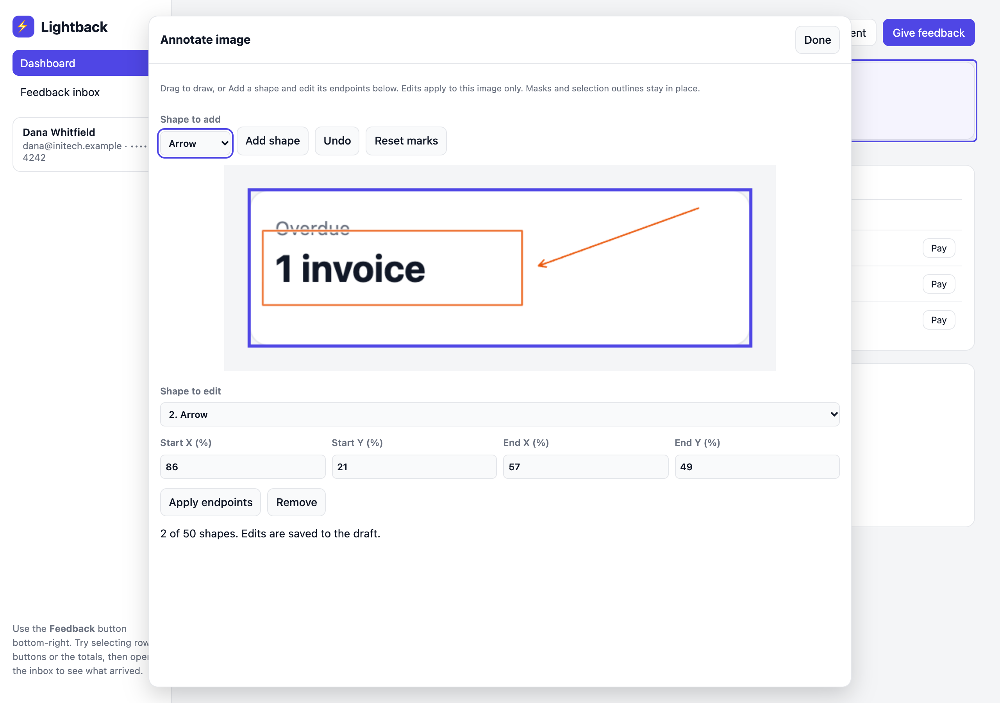
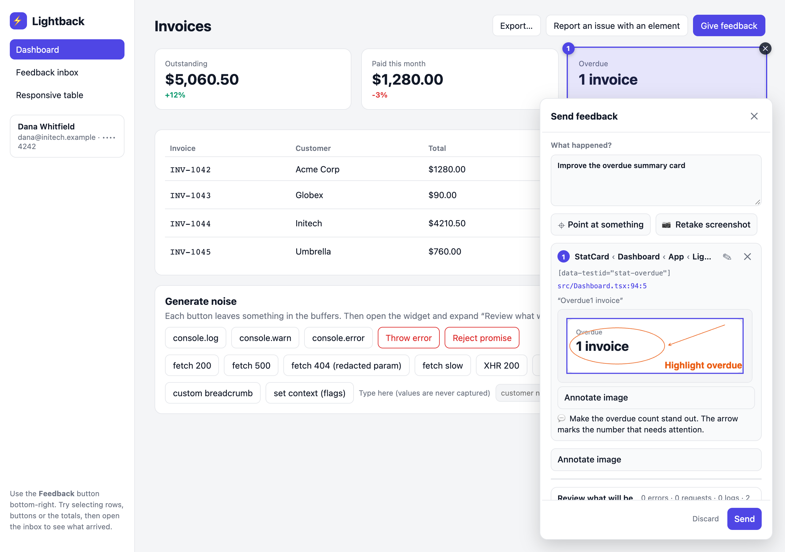

# Customization

Everything below is set on `mountWidget()` or `mountLazyWidget()` or, in React, on the `widget` prop of `LightbackProvider`.

::: info Release availability
`strings`, `theme`, `hideTrigger` and styling parts are available in `@lightback/widget` starting with **0.1.1**; `screenshotArea`, `screenshotMaxElements`, `domCapturer` and the capturer's `{ area }` argument starting with **0.2.2**.
:::

## Options

| Option | Type | Default | What it does |
| --- | --- | --- | --- |
| `client` | `LightbackClient` | required | The client from `createLightback()`. |
| `screenshot` | `({ area }) => Promise<Blob \| null>` | none | Captures `area` of the document. Omit to disable screenshots entirely. See [Screenshot capturer](#screenshot-capturer). |
| `screenshotArea` | `'page' \| 'viewport'` | `'page'` | What a capture covers. `'viewport'` keeps captures fast and small on long pages. |
| `autoScreenshot` | `boolean` | `true` when `screenshot` is set | Capture when pick mode starts and crop every selection. The panel also offers manual capture/retake whenever a capturer is supplied. |
| `screenshotMaxElements` | `number` | `8000` | Skip the automatic capture when it would clone more elements than this; the panel's Screenshot button still works. `Infinity` turns the check off. |
| `cropPadding` | `number` | `16` | CSS pixels of context around a selection in its crop. |
| `sendDelay` | `number` | `5000` | Milliseconds the "Sending…" card stays cancellable. `0` sends immediately. |
| `position` | `'bottom-right' \| 'bottom-left'` | `'bottom-right'` | Corner for the pill, panel and pending card. |
| `accent` | CSS color | `#4f46e5` | Buttons, highlights, pins and crop outlines. Shorthand for the `--lb-accent` variable. |
| `triggerLabel` | `string` | `'✎ Write feedback'` | Label of the pill's open button. Legacy alias; `strings.pillOpen` takes precedence. |
| `onSent` | `(payload) => void` | none | Called after a successful send. |
| `onError` | `(error) => void` | none | Called when the transport fails. The panel also reopens with the message. |
| `theme` | `'light' \| 'dark' \| 'auto'` | `'auto'` | Force a scheme or follow `prefers-color-scheme`. |
| `hideTrigger` | `boolean` | `false` | Hide the pill and drive the widget from your own UI through the handle. |
| `strings` | `Partial<WidgetStrings>` | English | Every visible label. See [Texts and i18n](./texts-and-i18n.md). |

## Colours and shape

The widget renders inside a Shadow DOM, so your stylesheet cannot reach its internals by accident. It exposes CSS custom properties on the host element instead. Set them on `lightback-widget` from any stylesheet:

```css
lightback-widget {
  --lb-accent: #0f766e;
  --lb-accent-contrast: #fff;
  --lb-bg: #ffffff;
  --lb-fg: #111827;
  --lb-muted: #6b7280;
  --lb-border: #e5e7eb;
  --lb-surface: #f9fafb;
  --lb-danger: #dc2626;
  --lb-radius: 12px;
  --lb-shadow: 0 10px 30px rgba(0, 0, 0, .18);
}
```

The widget uses a system sans-serif font. Override `font-family` on `lightback-widget` to match your app. Text direction is inherited; physical placement follows `position`.

Dark mode flips `--lb-bg`, `--lb-fg`, `--lb-muted`, `--lb-border` and `--lb-surface` under `prefers-color-scheme: dark`. Override them inside your own media query to tune it, or set `theme` to force one scheme.

**Styling parts.** For changes the variables cannot express, the pill, panel, popover and pending card carry `part` attributes (`pill`, `panel`, `popover`, `pending`) so `lightback-widget::part(pill) { … }` works. Variables stay the supported API; parts are the escape hatch and may change between minor versions.

## Position

`position` moves the whole widget to the bottom-left. There is no top placement. If you need the pill somewhere else, hide it and use your own trigger.

## Your own trigger

`mountWidget()` and `mountLazyWidget()` return a handle. The lazy handle loads UI on first `open()` or `startPicking()`; both methods return promises. Call it from any button:

```ts
const widget = mountWidget({ client: lightback, screenshot, hideTrigger: true });

document.querySelector('#report-bug')!.addEventListener('click', () => widget.startPicking());
document.querySelector('#feedback')!.addEventListener('click', () => widget.open());
```

In React, `useLightbackWidget()` returns the lazy handle once the mounting effect runs. `hideTrigger: true` keeps the pill hidden after closing, cancelling, discarding, or sending. Your buttons can reopen the widget at any time.

## Screenshot capturer

The capturer receives `{ area }`, a document rect in CSS pixels, and resolves to a PNG or JPEG `Blob` showing exactly that area, at any uniform scale. With `screenshotArea: 'page'` (the default) the area is the whole document; with `'viewport'` it is what is on screen. The widget hides itself and mutes the collectors while the function runs, so the capturer's own network calls never appear in the report.

The recommended setup wraps a DOM-cloning library with `domCapturer` and captures the viewport:

```ts
import { domCapturer } from '@lightback/widget'; // also exported by '@lightback/widget/lazy'

mountWidget({
  client: lightback,
  screenshotArea: 'viewport',
  screenshot: domCapturer((root, options) =>
    import('modern-screenshot').then((m) => m.domToBlob(root, { ...options, scale: Math.min(devicePixelRatio, 2) }))),
});
```

`domCapturer` passes `width`, `height`, `style` and `filter`, which both `modern-screenshot` (`domToBlob`) and `html-to-image` (`toBlob`) accept. Libraries like these copy every element they render, and the page stays frozen while they do: around 2.5 seconds per 10,000 elements. For a viewport area, `domCapturer` keeps elements entirely off screen as empty boxes. Their size holds the layout in place and nothing inside them is copied, so the cost follows what is on screen rather than the page's length. Elements whose content spills outside their own box (an app root with `height: 100%` on a long page, positioned descendants) and boxless `display: contents` elements are never emptied. Fixed elements are always kept and render where they are on screen. Sticky elements render unstuck, at their place in the page, so a header stuck to the top while scrolled is missing from the image. `domCapturer` also leaves the widget out of the image, so the widget stays visible and the comment box keeps focus while a capture runs; other capturers make the widget hide for the capture. On a 93,000-element page a whole-page capture took 25 seconds and a 23 MB PNG; a viewport capture took about 1 second and 250 KB.

With viewport captures, a selection the first capture does not show (because the page scrolled) gets its crop from a capture of the screen it was selected on; selections on that same screen share it. Every image attachment reports the area it shows as `attachments[].area`, so consumers can lay `docRect`s over it.

**Large pages.** Before an automatic capture the widget estimates how many elements the capturer will copy: the whole document for `'page'`, or what `domCapturer` copies for `'viewport'`. Above `screenshotMaxElements` (default 8000) it skips the capture and says so; the report still has every selection and its context, and the panel's Screenshot button captures on request.

Any other capturer works if it honours `area`:

```ts
// html2canvas, whole page
screenshot: ({ area }) => import('html2canvas').then(async (m) => {
  const canvas = await m.default(document.documentElement, { x: area.x, y: area.y, width: area.width, height: area.height });
  return new Promise<Blob | null>((r) => canvas.toBlob(r, 'image/png'));
})
```

Capturers written for earlier versions ignore the argument and return the whole page, which is what `'page'` asks for. Crops and privacy masks are placed on the image by document coordinates, so the image must show exactly the requested area. The widget masks sensitive elements and reporter-hidden areas after the capturer returns; see [Privacy and masking](./privacy.md#contract-with-your-capturer).

## Image annotations

In the review panel choose **Annotate image** above the screenshot or under a selection crop. Choose Rectangle or Arrow and drag across the image. For keyboard editing, choose **Add shape**, select a shape from **Shape to edit**, change its Start/End X/Y percentages, and choose **Apply endpoints**. Reversing an arrow's endpoints reverses its direction. **Remove** deletes the selected mark. **Undo** restores the previous edit; **Reset marks** removes all marks from that image and can itself be undone. Done or Escape returns to the report after PNG rendering finishes. Escape during a drag cancels that unfinished mark.



Coordinates are relative to the entire image, so preview resizing, device pixel ratio and document scroll do not shift marks. Each screenshot and crop has its own layer: editing the screenshot does not alter its crops. Existing selection outlines remain part of crop pixels. Marks are orange with a white edge for contrast. They draw over already masked pixels; they cannot undo a privacy mask, and are not a privacy tool themselves. Use **Hide area** to conceal content.

The editor holds up to 50 shapes per image, the screenshot plus up to 50 crops, and the last 20 undo steps during an editor session. Done keeps edits in the draft; closing and reopening starts a new undo history. Adding selections keeps an annotated screenshot; fresh captures supply the new crops. **Retake screenshot** explicitly replaces that screenshot and clears its marks. Recutting or dropping a crop after masking clears its marks; repainting the same screenshot with a new mask keeps its marks. Removing an image or Discard clears its layer. Failed sends keep edits.

The screenshot thumbnail shows the whole image, with letterboxing when needed. Previews display the same flattened PNGs that are sent, with the original bitmap dimensions and attachment `area`. Sending waits for image edits to finish; encoding failure retains the draft and surfaces an error. Done and Escape still let you leave a failed editor to remove the image or retry. There are no new payload fields and no additional attachments. With `persistence.attachments: true`, recovery stores the masked source image and bounded vector layer so marks remain editable after reload. Undo history is not persisted. Without image persistence (or if the image exceeds the recovery budget), its edit layer is omitted too.



Custom editors can use the optional draft-only `imageAnnotations` field: an array of `{ attachment, shapes }`, where each shape has `kind: 'rectangle' | 'arrow'` and normalized `x1`, `y1`, `x2`, `y2` endpoints between 0 and 1. The built-in widget flattens these before send; core does not render custom editors' images.

## Keeping the widget out of its own reports

Any element with `data-lightback-ignore` is invisible to the picker and the breadcrumb collector. The widget's host has it already. Use it on your own feedback button so a click on it is not recorded as a breadcrumb:

```html
<button id="report-bug" data-lightback-ignore>Report a bug</button>
```

Ignoring is not a privacy control. To keep user data out of reports and screenshots, use `data-lightback-sensitive` or `privacy.selectors` ([Privacy and masking](./privacy.md)).

## What the client controls

Capture, limits, recovery and redaction are client options, not widget options. See `createLightback()` in the README: `capture.networkBodies`, `limits.*`, `redact.headers`, `redact.urlParams`, `redact.patterns`, `privacy.selectors`, and `beforeSend`.

Redaction covers the complete payload before preview, `beforeSend` and delivery: page metadata, context, breadcrumbs, errors, selections and attachment names all use your rules. Secret-named fields and embedded URLs/JSON are scrubbed too. `beforeSend` remains a trusted host hook for further changes. Text rules cannot mask screenshot pixels; sensitive elements can.

Click breadcrumbs and element text exclude form control and contenteditable contents, including nested or containing elements. Network bodies are opt-in and same-origin only; response capture also checks the final response URL after redirects. Unknown or cross-origin final URLs omit the response body while retaining request metadata.

## Theme and styling parts

```ts
mountWidget({ client: lightback, theme: 'dark', position: 'bottom-left' });
```

```css
lightback-widget::part(panel) { width: 420px; }
lightback-widget::part(pill) { border-radius: 8px; }
```

The other exposed parts are `popover` and `pending`. `theme: 'auto'` follows system changes without remounting. Options are read at mount time; remount to switch a forced theme or translation table.

## Restore work after reload

Session recovery is enabled by default. Lightback checkpoints bounded console, errors, network and breadcrumb buffers, the report text, selections and selection notes to IndexedDB. A random sessionStorage key scopes recovery to the current tab and origin. The lazy trigger shows recovered selection counts without downloading the editor. Restored reports are editable; picking and pending-send timers never restart automatically.

```ts
const lightback = createLightback({
  endpoint: '/api/feedback',
  persistence: {
    key: 'my-app',       // use a different namespace for each client on the origin
    maxAge: 15 * 60_000, // expiry since last checkpoint; default/maximum 30 minutes
    maxBytes: 5 * 1024 * 1024, // default 5 MiB per snapshot
    attachments: false, // default; stored images are masked, but only for content you marked
  },
});
// Or disable all recovery storage access:
createLightback({ endpoint: '/api/feedback', persistence: false });
```

Text and metadata are redacted before storage using the configured rules. Inspection HTML and form-value props are omitted, and form controls are excluded from inspected ancestor text. Draft recovery keeps at most 50 selections; string values are capped by `limits.string` and collector counts by their buffer limits. App context is supplied fresh by the host and is not persisted. `beforeSend` runs only when sending, so put storage redaction rules in `redact`.

Screenshot and crop blobs are **not persisted by default**. Set `persistence.attachments: true` to retain them in IndexedDB. Only masked images are stored: sensitive elements and reporter-hidden areas are covered ([Privacy and masking](./privacy.md)). Typed form values and other unmarked content remain visible in pixels; mark those fields sensitive. Text redaction cannot scrub pixels. Oversized attachments are omitted from recovery, with their crop references removed (also when recovery switches to metadata-only); an oversized metadata snapshot is deleted. These recovery bounds do not remove attachments from the current live report.

Successful send and Discard clear the stored draft and collector buffers. Successful send also clears edits and events made while it was in flight; custom editors should await send before starting another report. A failed or vetoed send retains current edits and buffers. Discard or widget destruction while a send is still waiting for screenshot/crop jobs cancels that send; transport already in progress is not aborted. `await lightback.clearPersistence()` also clears both, for example on logout before destroying the client. Pending fetch/XHR requests and body reads cannot repopulate cleared buffers. Collection of new activity continues until `destroy()`, which also invalidates pending captures without aborting application requests. Multiple clients can be destroyed in any order without stopping each other’s collectors. Disabling persistence avoids reading or writing recovery storage; it does not erase old records, which expire normally.

Checkpoints are coalesced over 100 ms, with best-effort flushes on hiding the page and teardown. A browser crash or immediate navigation can lose the last uncommitted edit or unfinished capture. Storage denial, quota errors or a blocked database leave the widget usable in memory; failed writes invalidate the session key so an older snapshot cannot return. Records have a separate schema version and expire 30 minutes after their last checkpoint by default. Expired/incompatible records are removed the next time recovery storage opens. Closing a tab normally loses its session key; browser session restore or tab duplication may preserve/copy sessionStorage, so the expiry still applies. IndexedDB records can remain physically stored until that cleanup or the user clears site data.

For a custom editor, `await lightback.ready` before reading `lightback.getDraft()`, checkpoint edits with `lightback.saveDraft(draft)`, and use `await lightback.flushPersistence()` before navigation you control. The built-in widget does this automatically. Use one client/editor per persistence key. Recovery is separate from the public demo's IndexedDB inbox of already-sent reports.
