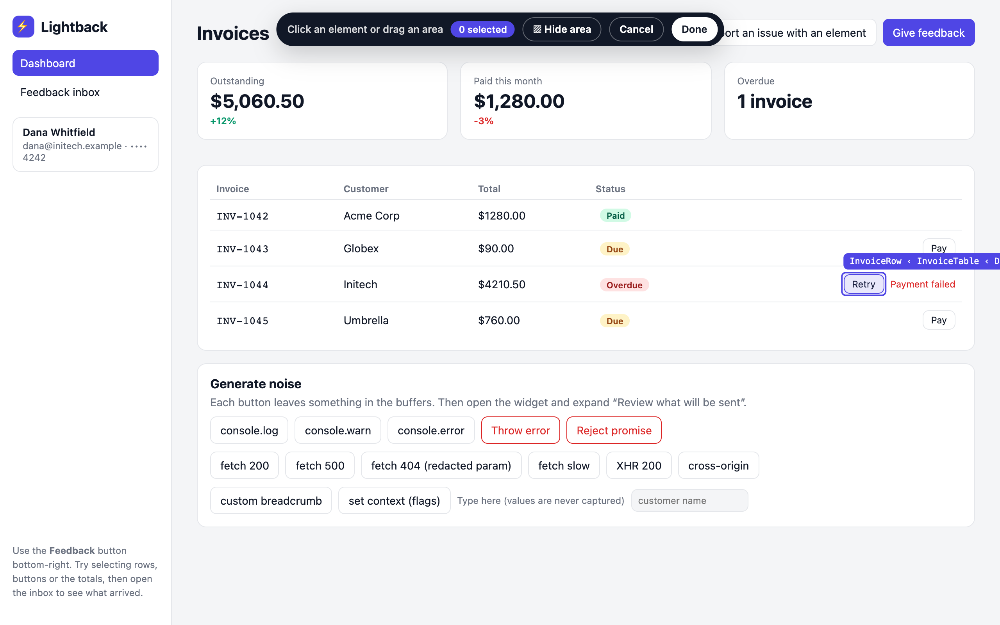

<div class="lb-home">

## A small addition to your app

```sh
pnpm add @lightback/core @lightback/widget
```

```ts
import { createLightback } from '@lightback/core';
import { mountWidget } from '@lightback/widget';

const client = createLightback({ endpoint: '/api/feedback' });
mountWidget({ client });
```

Mount after the DOM is ready. Add an optional screenshot capturer to include the images shown below. Works with React, Vue, Svelte, or plain JavaScript.

## From “this is broken” to a report you can use

<div class="lb-gallery">
  <figure>
    
    <figcaption><strong>01 · Point.</strong> Pick an element or drag across the area you mean.</figcaption>
  </figure>
  <figure>
    
    <figcaption><strong>02 · Comment.</strong> Keep the note attached to the thing you selected.</figcaption>
  </figure>
  <figure>
    
    <figcaption><strong>03 · Send.</strong> A five-second window lets you cancel or edit.</figcaption>
  </figure>
  <figure>
    
    <figcaption><strong>04 · Investigate.</strong> Your receiver gets the context. This inbox is the example app.</figcaption>
  </figure>
</div>

[Install Lightback →](./guide/getting-started.md) · [Build your receiver →](./guide/backend.md)

</div>
